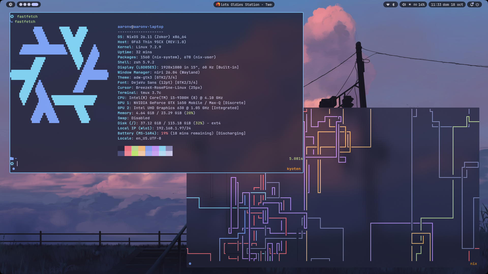

# Nixos Configurations



Personal NixOS and nix-darwin configuration by [Aaron Vargas](https://github.com/aaron70).

---

## Hosts

| Host | Arch | OS | User | GPU | Desktop | Notes |
|------|------|----|---------|-----|----------|-----|
| `pc` | x86_64 | NixOS | aaronv | NVIDIA | niri + Noctalia | Personal computer, for gaming and development. |
| `laptop` | x86_64 | NixOS | aaronv | NVIDIA | niri + Noctalia | Personal laptop, for development. |
| `gpd` | x86_64 | NixOS (Jovian) | aaronv | AMD | niri + Noctalia | Handheld console, for gaming and occasionally development. |
| `mac` | aarch64 | macOS | aaronv-work | Apple Silicon | AeroSpace | Work computer. |


## Nix aliases

The shell installs host-specific aliases (baked for the host you're on, pointing at `host.metadata.nixPath`):


| Alias | Runs | OS  |
|-------|------| --- |
| `nswitch` | `nh os switch <nixPath> -H <this-host>` | `nixos` `darwin` |
| `nclean` | `nh clean all --optimise -k <configurationLimit>` | `nixos` `darwin` |
| `nshell` | `nix-shell --command <shell> -p` | `nixos` `darwin` |
| `ntest` | `nh os test <nixPath> -H <this-host>` | `nixos` |
| `nboot` | `nh os boot <nixPath> -H <this-host>` | `nixos` |
| `nbuild-vm` | `nh os build-vm <nixPath> -H <this-host>` | `nixos` |


Manually (e.g. from a machine without the aliases):

```sh
# Rebuild and switch
sudo nixos-rebuild switch --flake .#pc       # pc | laptop | gpd
darwin-rebuild switch --flake .#mac          # mac

# Update inputs
nix flake update                             # all inputs
nix flake lock --update-input nixpkgs        # a single input

# Format all files (alejandra)
nix fmt
```


## Workflows

> Supported platforms: `nixos`, `darwin` and `home`

### Test a change in a VM

`nbuild-vm` boots the host in a QEMU VM. It uses `virtualisation.vmVariant`, which forces the password secret off and sets a fixed `initialPassword = "anvil"` (see `modules/users/aaronv.nix`).

### Add a new host

1. Create the host file on _**modules/hosts/<name>.nix**_ file, declaring `anvil.hosts.<name>`.
    * Define the system target platform `systems.<platform>`. (e.g. **x86_64-linux**)
    * Define the list of `users` the host have.
    * Define the list of `programs` and `features` the host will install.
    * Define the `metadata` for the host. (e.g. The `nixPath` for the aliases)
    * Define the code fragments for the host `<platform>` with the nix code for the host.
2. Register the machine's age key in `.sops.yaml` (see [Secrets](#security)).
3. Build the host `sudo nixos-rebuild switch --flake .#<name>`

### Add a feature or program

1. Create the _**modules/features/<name>.nix**_ or the _**modules/programs/<name>.nix**_ files declaring `anvil.features.<name>` and `anvil.programs.<name>` respectively.
    * Define the code fragments `<platform>` with the nix code for the feature/program.
    * Define the list of `programs` for the feature/program.
    * Define the list of `features` for the feature/program.
    * (**Only programs**) For programs you can define a function `getPackage` to get the package of the program.
2. Reference it by name (or a refkey) from any entity via the `features` or `programs` fields. The `modules/` import-tree automatically registers it with the flake options.

### Add a user

1. Create the _**modules/users/<name>.nix**_ file declaring `anvil.users.<name>`.
    * Define the `name` and `description` of the user.
    * Define the code fragments `<platform>` with the nix code for the user.
    * Define the `metadata` for the user. 
    * Define the list of `programs` and `features` the user will install. 
    * Define the `homeDir.nixos` and `homeDir.darwin` to set the home directory for each OS.
2. Reference it by name (or a refkey) from the host via the `users` field. The `modules/` import-tree automatically registers it with the flake options.

## Security 

### Secrets

Secrets use [sops-nix](https://github.com/Mic92/sops-nix) with age keys.

* On first activation each host generates its own age keypair at `/var/lib/sops-nix/key.txt` `SOPS_AGE_KEY_FILE` points there.
* `.sops.yaml` lists the keys registered. A device can only decrypt (and edit) secrets if its public key appears in that file.
* `modules/secrets/<name>.yaml` holds the encrypted secrets, wired by the associated `modules/secerts/<name>.nix` feature.

`age` and `sops` are installed on every host and the `sops` feature already exports `SOPS_AGE_KEY_FILE=/var/lib/sops-nix/key.txt`, so these commands work out of the box on a managed host, just use `sudo` to use the host key.
The prefix is only needed when running outside a host that doesn't set it or with another key.

**Commands**

```sh
# Edit a secret (opens your $EDITOR on the decrypted file)
SOPS_AGE_KEY_FILE=/path/to/key.txt sops modules/secrets/<name>.yaml

# Set a single value (no editor)
SOPS_AGE_KEY_FILE=/path/to/key.txt sops set modules/secrets/<name>.yaml '["password"]' '<value>'

# Read/verify without touching the file
SOPS_AGE_KEY_FILE=/path/to/key.txt sops -d modules/secrets/<name>.yaml
SOPS_AGE_KEY_FILE=/path/to/key.txt sops -d --extract '["email"]' modules/secrets/<name>.yaml

# Give a new device access:
age-keygen -o /tmp/key.txt          # 1. generate a keypair
age-keygen -y /tmp/key.txt          # 2. prints its public key -> age1...
#                                     3. add `- &<name>  age1...` under `keys:` and `- *<name>` in the creation rule of `.sops.yaml`
SOPS_AGE_KEY_FILE=/path/to/key.txt sops updatekeys modules/secrets/<name>.yaml   # 4. re-encrypt with the new recipient set

# Rotate the data key (re-encrypts in place)
SOPS_AGE_KEY_FILE=/path/to/key.txt sops -r -i modules/secrets/<name>.yaml
```

If a machine can't decrypt (e.g. git user/email missing), its key likely isn't in `.sops.yaml` yet — see [Troubleshooting](#troubleshooting).

## Troubleshooting

### No git user and email

Git's `user.name` / `user.email` come from the sops-rendered `gitconfig-personal` template. If they're missing, the secrets are not being decrypted — make sure this device's age key is registered in `.sops.yaml` (see [Secrets](#security)) and rebuild.

### No audio on headsets

Open `pavucontrol` or `Bluetooth Manager` and change the audio profile. Currently works with `High Fidelity Playback (A2DP Sink, codec AAC)`.

### Setup the monitors position

`wdisplays` is installed for setting up monitor positions. Set the positions within the application and then copy the values into `anvil.desktop.preferences.monitors` in the host's module (`modules/hosts/<host>.nix`).
